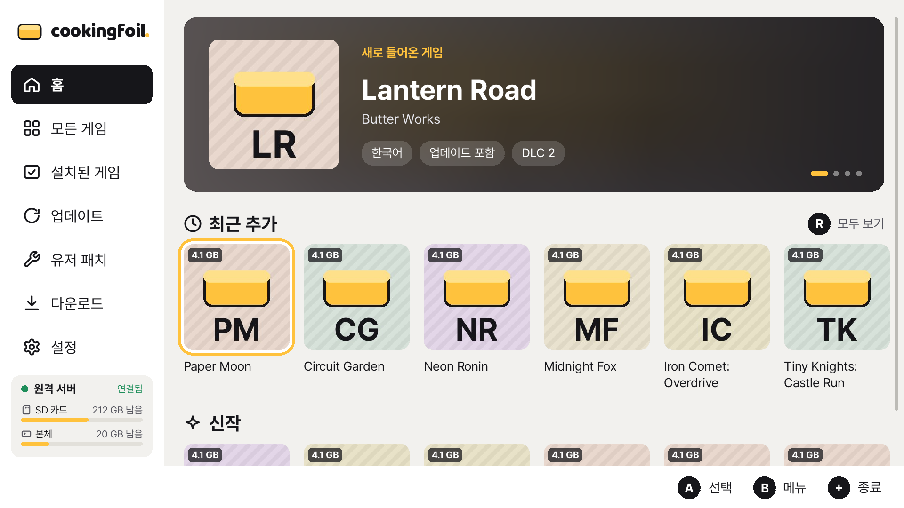
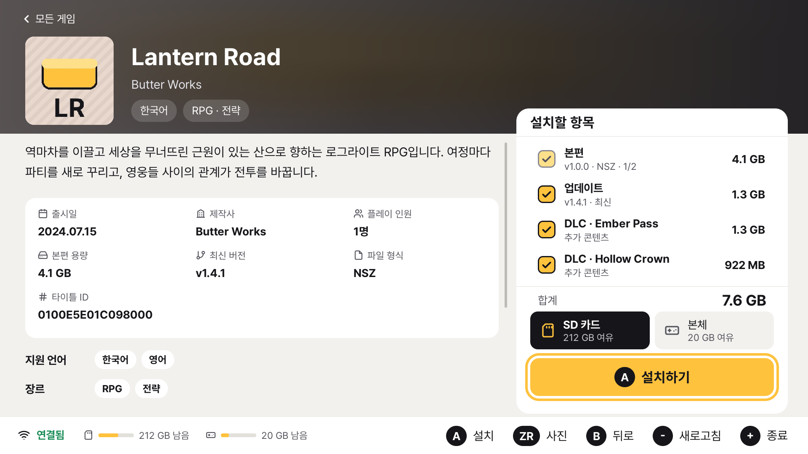
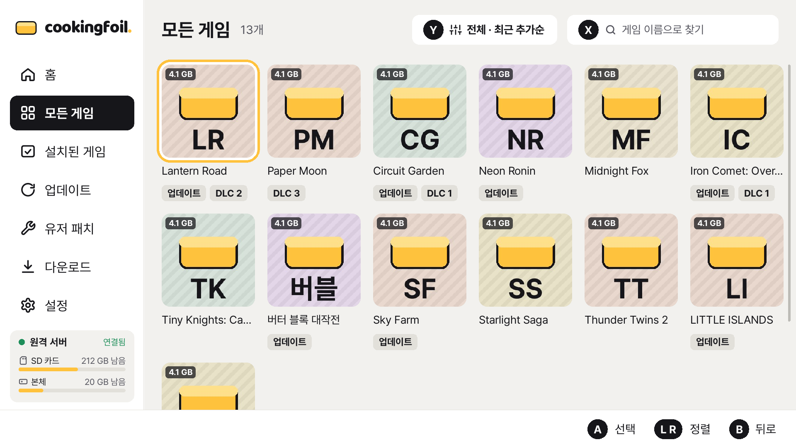
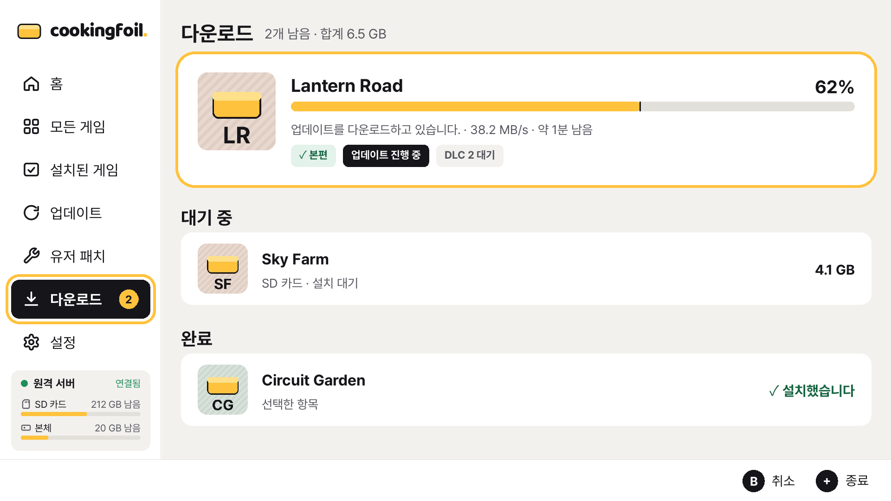
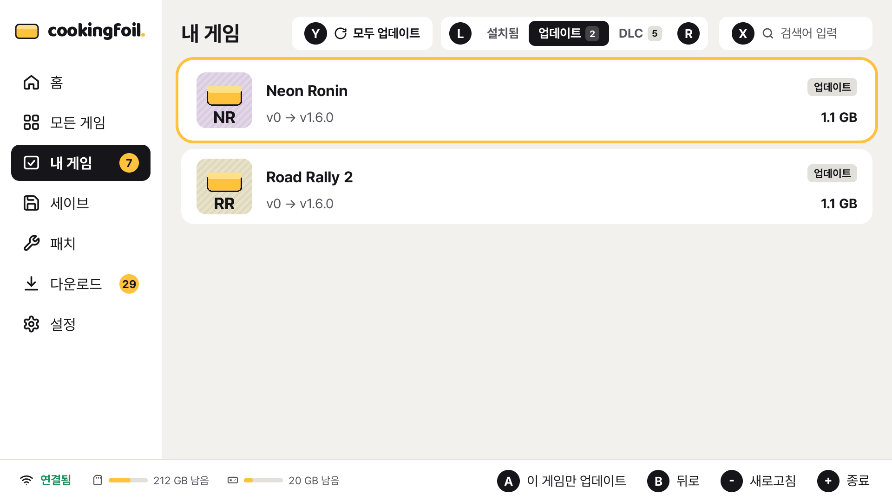
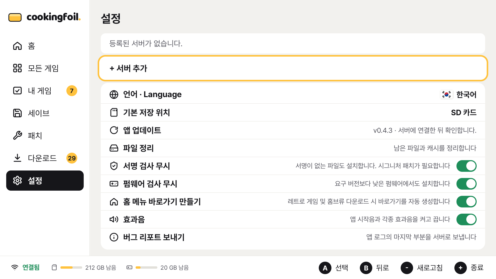

# CookingFoil

[English](README.md)

CookingFoil은 본체용 개인 홈브루 파일 클라이언트입니다. 직접 운영하는
[CookingFoil 서버](https://github.com/jshsakura/oc-cookingfoil)에 연결해 그 서버에 둔 파일을 둘러보고
본체에 설치합니다.

이 클라이언트는 **[CookingFoil 서버](https://github.com/jshsakura/oc-cookingfoil)**와 짝을 이룹니다.
서버는 MIT 라이선스의 자체 호스팅 서버이며 `deploy/` 폴더에 운영 예시가 있습니다. 서버를 먼저
준비한 뒤 이 앱을 연결합니다.

> **안내.** 독립된 오픈소스 프로젝트이며 소프트웨어·키·BIOS·RetroArch를 포함하지 않습니다.
> 합법적으로 소유한 콘텐츠만 설치합니다.

| 홈 | 게임 상세 | 모든 게임 |
|---|---|---|
|  |  |  |
| **다운로드** | **업데이트** | **설정** |
|  |  |  |

스크린샷의 게임 이미지는 임시 그림입니다.

## 기능

- **홈 줄:** 최근 추가, 할인, 신작, 업데이트, 인기, 높은 평점, 멀티플레이, 파티, 장르별 줄을 보여 줍니다.
- **모든 게임:** 필터, 정렬, 검색을 지원합니다.
- **게임 상세:** 설명, 정보, 스크린샷을 보여 주고 본편, 업데이트, DLC를 골라 SD 카드나 본체 저장 공간에 설치합니다.
- **HTTP 설치:** [CyberFoil](https://github.com/luketanti/CyberFoil) 설치 엔진으로 NSP, NSZ, XCI, XCZ를 설치합니다.
- **설치 대기열과 이어 받기:** 중간에 끊기면 다 받은 콘텐츠는 남기고, 연결이 끊기면 다시 연결될 때까지 기다리며, 다음 실행 때 이어서 설치할지 묻습니다. 받는 동안 본체가 절전 모드로 들어가지 않습니다.
- **업데이트 화면:** 설치된 버전과 서버의 버전을 비교합니다.
- **설치된 게임 관리:** 게임이나 세이브를 삭제합니다. 기본 선택은 취소입니다.
- **유저 패치:** LayeredFS romfs/exefs, 빌드 ID별로 합치는 치트, `exefs_patches`, FPSLocker를 지원합니다.
- **남은 파일 정리:** 설정에서 확인을 받은 뒤, 설치된 타이틀이 참조하지 않는 콘텐츠와 끝나지 않은 설치의 placeholder를 지웁니다.
- **QR 기기 승인:** 서버와 기기를 QR로 연결합니다.
- **언어:** 한국어, 영어, 일본어, 중국어를 지원합니다. 설정에서 고르며 기본값은 본체 언어입니다.
- **터치와 컨트롤러** 입력을 지원합니다.
- **브라우저 미리보기:** PC에서 실제 화면 코드를 실행해 브라우저로 확인합니다.

## 요구 사항

- 홈브루 앱을 실행할 수 있는 본체가 필요합니다. 예를 들어 [Atmosphère](https://github.com/Atmosphere-NX/Atmosphere)로 실행합니다.
- 사용 권한이 있는 CookingFoil 서버가 필요합니다.

CookingFoil은 devkitPro와 libnx로 빌드합니다. 지원하는 펌웨어 범위는 Atmosphère와 libnx를 따릅니다.

## 설치

1. [Releases](../../releases) 페이지에서 `cookingfoil.nro`를 받거나 직접 빌드합니다.
2. SD 카드의 `sdmc:/switch/cookingfoil/cookingfoil.nro`에 복사합니다.
3. 같은 폴더에 `config.json`을 넣습니다(아래 참고).
4. 홈브루 메뉴에서 CookingFoil을 실행합니다.

## 설정

앱은 `sdmc:/switch/cookingfoil/config.json`을 읽습니다. PC에서 파일을 고친 뒤 설정 화면에서
Y를 누르면 다시 읽습니다. 서버 관리 페이지에서 사용자를 만들면 완성된 `config.json`을 보여 주며,
로그인한 브라우저는 `/api/client-config`에서 받을 수 있습니다(비밀번호와 키는 넣지 않습니다).

```json
{
  "servers": [
    {
      "title": "내 서버",
      "url": "https://files.example.com",
      "username": "",
      "password": "",
      "enabled": true
    },
    {
      "title": "예비 서버",
      "url": "https://files2.example.com",
      "cfClientId": "",
      "cfClientSecret": "",
      "enabled": false
    }
  ],
  "language": "ko",
  "installTarget": "sd"
}
```

| 키 | 뜻 |
|---|---|
| `servers[].title` | 앱에 보이는 이름 |
| `servers[].url` | 서버 주소 |
| `servers[].username`, `password` | 서버가 쓰는 경우의 HTTP Basic 계정 |
| `servers[].cfClientId`, `cfClientSecret` | 서버가 Cloudflare Access 뒤에 있는 경우의 서비스 토큰 |
| `servers[].enabled` | 서버 사용 여부 |
| `language` | `ko`, `en`, `ja`, `zh` 중 하나 |
| `installTarget` | `sd`(SD 카드) 또는 `nand`(본체 저장 공간) |

영어 예시는 [docs/config.example.json](docs/config.example.json)에 있습니다.

### 기기 승인

서버가 기기 승인을 요구하면 본체에 QR 코드가 나옵니다. 휴대폰으로 스캔하면 관리자가 기기를
승인합니다. 승인되면 CookingFoil이 알아서 연결하고 접근 키를 `sdmc:/switch/cookingfoil/state.json`에
저장합니다. 본체에서 주소나 비밀번호를 입력하지 않습니다. 이 기능을 지원하는 서버 버전이 필요합니다.

## 서버

CookingFoil은 [CookingFoil 서버](https://github.com/jshsakura/oc-cookingfoil)(MIT)와 통신합니다.
게임 목록은 서버에 있는 실제 파일 목록이고, 클라이언트가 이를 본편, 업데이트, DLC로 묶습니다.

## 빌드

서브모듈과 함께 받습니다.

```sh
git clone --recursive https://github.com/jshsakura/oc-cookingfoil-client
cd oc-cookingfoil-client
```

### 본체

[devkitPro](https://devkitpro.org/wiki/Getting_Started)와 다음 패키지를 설치합니다.

```sh
dkp-pacman -S switch-sdl2 switch-sdl2_ttf switch-sdl2_image switch-curl switch-mbedtls \
  switch-json-c switch-freetype switch-harfbuzz switch-libwebp switch-libpng \
  switch-libjpeg-turbo switch-zstd switch-zlib switch-bzip2
```

그다음 `make`를 실행합니다. `third_party/patches`의 엔진 패치를 적용하고 `cookingfoil.nro`를
만듭니다. `DEVKITPRO`가 없으면 `devkitpro/devkita64` 도커 이미지 안에서 빌드합니다.

### 호스트 빌드, 테스트, 브라우저 미리보기

호스트 빌드에는 SDL2, SDL2_ttf, SDL2_image, json-c, libcurl 개발 패키지가 필요합니다.
우분투에서는 [CI](.github/workflows/ci.yml)와 같이 설치합니다.

```sh
sudo apt-get install libsdl2-dev libsdl2-ttf-dev libsdl2-image-dev libjson-c-dev \
  libcurl4-openssl-dev libssl-dev fonts-noto-cjk ripgrep
make test     # 단위 테스트
make host     # build-host/cookingfoil-host
```

호스트 실행 파일은 본체와 같은 화면 코드로 거치 모드(1920x1080) 화면을 그립니다. `--serve`를
주면 브라우저로 화면을 보내고 키보드, 버튼, 마우스 입력을 그대로 받습니다.

```sh
./build-host/cookingfoil-host --fixture host/fixtures --serve 38520   # 예제 데이터
./build-host/cookingfoil-host --config <파일> --serve 38520             # 실제 서버
```

`http://localhost:38520/`을 엽니다. `--shot <폴더>`를 주면 PNG 스크린샷을 저장합니다.
미리보기는 인증 없이 모든 네트워크 인터페이스에서 받으므로 신뢰할 수 있는 네트워크에서만 사용합니다.

## 프로젝트 구조

설치 엔진을 고정하고 패치하는 방법은 [third_party/README.md](third_party/README.md)에 있습니다.

## 함께 작업하기

이 프로젝트가 지켜 온 규칙을 이유와 코드 위치와 함께 정리해 두었습니다:
[디자인](docs/DESIGN.md), [문구와 번역](docs/WRITING.md), [작업 규칙](docs/CONTRIBUTING-GUIDE.md).
풀 리퀘스트 전에 읽어 주십시오.

## 라이선스

CookingFoil은 [GNU General Public License v3.0 이상](LICENSE)으로 배포합니다. GPL 라이선스인
CyberFoil 설치 엔진을 함께 컴파일하며, CyberFoil은 Awoo Installer와 Tinfoil에서 파생했습니다.
서드파티 구성 요소와 라이선스는 [THIRD_PARTY_NOTICES.md](THIRD_PARTY_NOTICES.md)에 있습니다.
