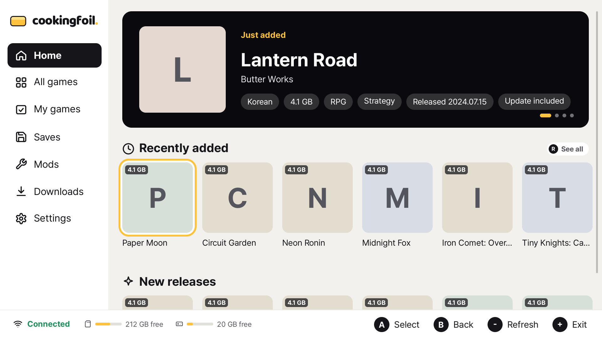
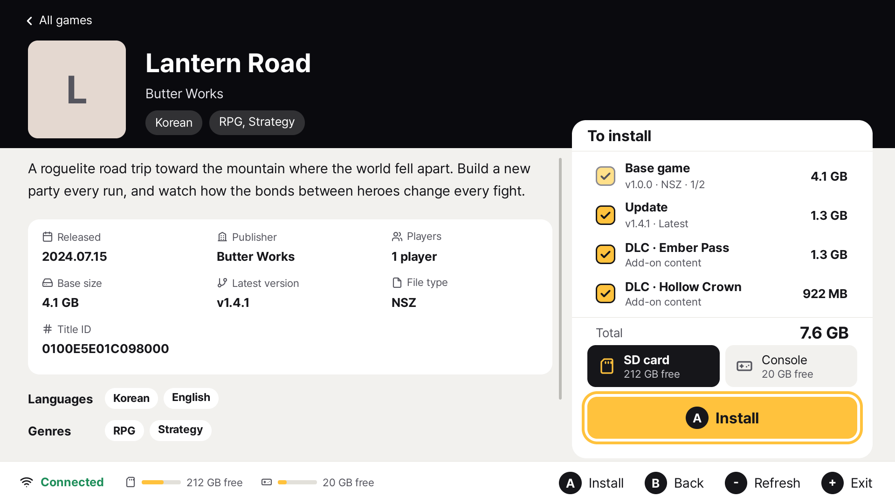
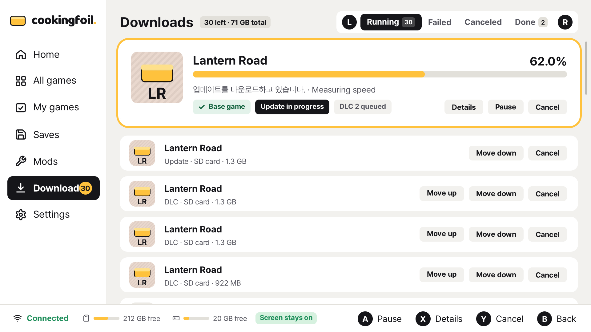
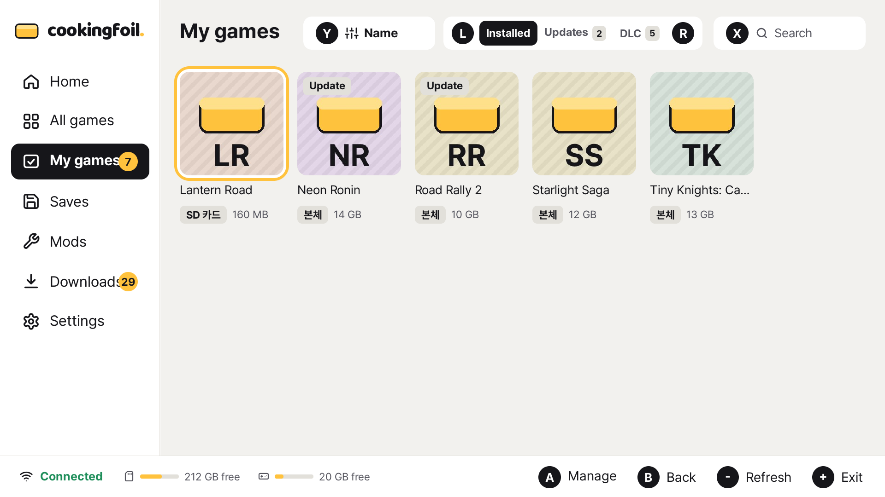
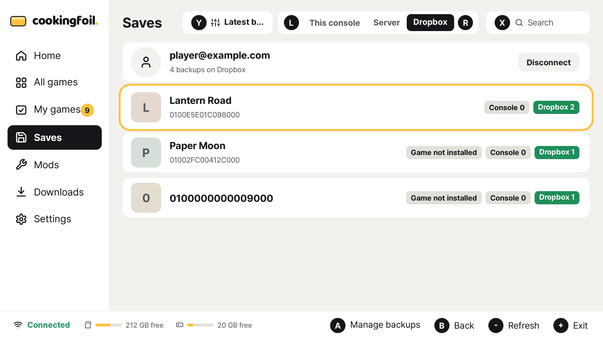

<div align="center">
  <h1></h1>
  <p><strong>파일은 서버에. 설치와 관리는 본체에서.</strong></p>
  <p>게임, 홈브루, 세이브, 패치를 한곳에서 관리하는 개인용 홈브루 클라이언트입니다.</p>
  <p><a href="https://github.com/jshsakura/oc-cookingfoil#connecting-a-client">클라이언트 받기</a> · <a href="https://jshsakura.github.io/oc-cookingfoil/">웹사이트</a> · <a href="https://github.com/jshsakura/oc-cookingfoil">서버 준비하기</a> · <a href="docs/README.md">문서</a></p>
  <p><a href="README.md">English</a> · <a href="README.ko.md">한국어</a></p>
  <a href="https://github.com/jshsakura/oc-cookingfoil-client/actions/workflows/ci.yml"></a>
  <a href="https://github.com/jshsakura/oc-cookingfoil-client/releases"></a>
  <a href="LICENSE"></a>
</div>



직접 운영하는 [CookingFoil 서버](https://github.com/jshsakura/oc-cookingfoil)에 연결해 파일을 둘러보고,
필요한 항목을 골라 설치합니다. 여러 서버의 목록을 함께 보고, 설치된 버전과 업데이트를 비교하고,
중간에 끊긴 다운로드는 이어서 진행합니다.

## 둘러보기

| 게임 상세 | 다운로드 |
|---|---|
|  |  |
| 설치된 게임 | 세이브와 Dropbox |
|  |  |

실제 영문 UI를 예제 데이터로 촬영했습니다. 아이콘이 없는 항목은 앱이 원래 표시하는 제목 첫 글자 타일입니다.

## 고르는 일에 집중하세요

| 하고 싶은 일 | CookingFoil이 챙기는 것 |
|---|---|
| **둘러보고 설치하기** | 검색·필터·정렬과 게임 상세, 본편·업데이트·DLC 선택, SD 카드·본체 저장 공간 선택을 지원합니다. NSP·NSZ·XCI·XCZ 설치에는 CyberFoil 엔진을 사용합니다. |
| **여러 서버 함께 쓰기** | 여러 서버의 목록을 모아 보고, 같은 항목을 제공하는 서버 중 다운로드할 곳을 고릅니다. |
| **다운로드 이어가기** | 대기열과 완료·실패·취소 기록을 보관합니다. 지원되는 다운로드는 중단 지점부터 이어 받고, 연결이 돌아오기를 기다립니다. 받는 동안 절전 모드로 들어가지 않습니다. |
| **최신 상태 확인하기** | 설치된 게임과 서버의 버전을 비교합니다. 홈브루는 서버가 알려 준 콘텐츠 해시로 업데이트 여부를 확인합니다. |
| **홈브루 관리하기** | 단일 NRO나 앱 폴더를 설치하고 업데이트합니다. 지원되는 앱의 HOME 메뉴 바로가기도 만듭니다. |
| **세이브 보관하기** | 사용자별 로컬 백업·복원, 서버 세이브 가져오기, Dropbox 업로드·다운로드를 지원합니다. 복원 전에는 되돌림용 백업을 만듭니다. |
| **패치 적용하기** | 게임 파일·치트·IPS·FPSLocker 패치를 켜고 끕니다. 파일 충돌을 확인하고, 치트는 빌드 ID별로 합칩니다. |
| **레트로 라이브러리 쓰기** | 서버의 시스템별 목록에서 게임을 골라 필요한 묶음을 받습니다. 서버가 제공하는 RetroArch 팩, 바로가기와 RetroAchievements 정보를 지원합니다. |
| **저장 공간 정리하기** | 설치된 게임 관리와 남은 파일 정리를 제공합니다. 삭제는 확인을 거치며, 정리는 설치된 타이틀이 참조하지 않는 콘텐츠를 대상으로 합니다. |

한국어·영어·일본어·중국어, 터치·컨트롤러 입력을 지원합니다. 홈브루·패치·레트로와 일부 연동 기능은
서버가 제공하는 기능에 따라 표시됩니다. 세이브와 패치 적용은 사용자가 선택합니다.

## 시작하기

1. **서버를 준비합니다.** [CookingFoil 서버 안내](https://github.com/jshsakura/oc-cookingfoil/blob/main/README.ko.md)를 따라 직접 설치하거나, 사용 권한이 있는 서버를 준비합니다.
2. **클라이언트를 넣습니다.** 서버 웹페이지에 로그인해 `cookingfoil.nro`를 받고 SD 카드의 `switch/cookingfoil/` 폴더에 복사합니다. 서버 운영자가 클라이언트 빌드를 준비해야 합니다.
3. **서버를 연결합니다.** 홈브루 메뉴에서 앱을 열고 **설정 → 서버 추가**에서 주소를 입력합니다. PC에서 `config.json`을 만들어 넣어도 됩니다.
4. **기기를 승인합니다.** 승인이 필요한 서버는 본체에 QR 코드를 보여 줍니다. 휴대폰에서 로그인해 승인하면 본체가 연결됩니다.

홈브루 앱을 실행할 수 있는 본체가 필요합니다. 세이브 관리 등 본체 권한이 필요한 작업은
애플리케이션 모드로 실행합니다. 애플릿 모드에서 접근할 수 없으면 앱이 실행 방법을 안내합니다.

설정 예시, 인증과 여러 서버 연결은 [시작 안내](docs/GETTING-STARTED.md)에 있습니다.

## 개발과 미리보기

C++17·SDL2로 만든 실제 UI를 PC에서도 실행할 수 있습니다. 예제 데이터로 화면을 살펴보거나,
서버에 연결해 브라우저에서 조작할 수 있습니다.

```sh
git clone --recursive https://github.com/jshsakura/oc-cookingfoil-client
cd oc-cookingfoil-client
# 먼저 빌드 안내의 호스트 의존성을 설치합니다.
make test host
./build-host/cookingfoil-host --fixture host/fixtures --lang ko --serve 38520
```

`http://localhost:38520/`을 엽니다. 본체 설치·세이브 접근·삭제는 실기기에서 확인합니다.
의존성, 본체 빌드와 화면 촬영은 [빌드 안내](docs/BUILDING.md)에 있습니다.

## 더 알아보기

| 문서 | 내용 |
|---|---|
| [시작 안내](docs/GETTING-STARTED.md) | 설치, 설정, QR 승인, 여러 서버, SD 카드의 파일 |
| [기능 안내](docs/FEATURES.md) | 다운로드, 홈브루, 세이브, 패치, 레트로의 동작과 조건 |
| [빌드와 미리보기](docs/BUILDING.md) | 호스트·본체 빌드, 테스트, 브라우저 미리보기 |
| [디자인 규칙](docs/DESIGN.md) | 화면 구성, 포커스, 입력과 피드백 |
| [문구와 번역](docs/WRITING.md) | 영문 번역 키, 네 언어의 문구와 작성 규칙 |
| [작업 규칙](docs/CONTRIBUTING-GUIDE.md) | 스레드, 파일 안전성, 테스트와 PR 절차 |
| [서드파티 구성](third_party/README.md) | 설치 엔진과 패치 관리 |

## 라이선스와 콘텐츠

클라이언트는 [GPL-3.0-or-later](LICENSE), 별도 프로젝트인 서버는 MIT 라이선스입니다.
클라이언트는 Awoo Installer와 Tinfoil에서 파생한 [CyberFoil](https://github.com/luketanti/CyberFoil)의
설치 엔진을 사용합니다. 구성 요소별 라이선스는 [서드파티 고지](THIRD_PARTY_NOTICES.md)에 있습니다.

게임, 키, BIOS, RetroArch는 포함하지 않습니다. 합법적으로 소유하거나 사용 권한이 있는 콘텐츠와
배포가 허용된 패치만 사용합니다.
