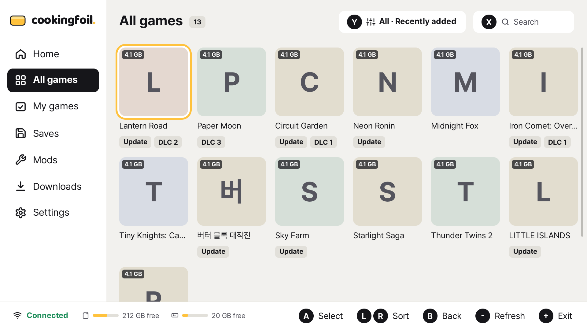
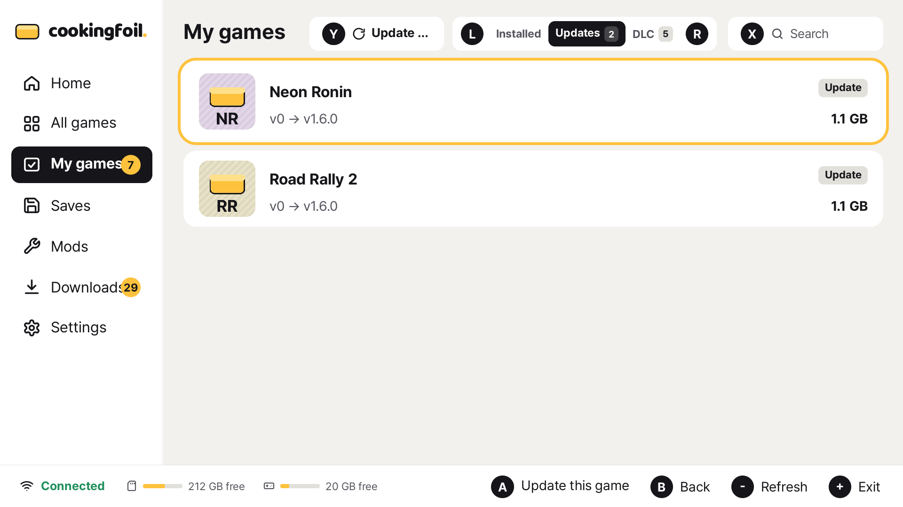
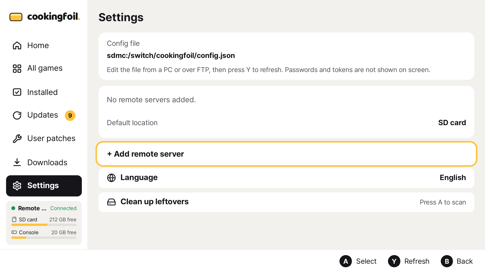

# CookingFoil

[한국어](README.ko.md)

CookingFoil is a personal homebrew file client for the console. It connects to your own
self-hosted [CookingFoil server](https://github.com/jshsakura/oc-cookingfoil), lists the files you
keep there and installs them to the console.

This client pairs with the **[CookingFoil server](https://github.com/jshsakura/oc-cookingfoil)**
(MIT, self-hosted, with production examples in its `deploy/` folder). Set up a server first,
then point this app at it.

> **Notice.** An independent open-source project; it includes no software, keys, BIOS or RetroArch.
> Only install content you legally own.

| Home | Game detail | All games |
|---|---|---|
|  |  |  |
| **Downloads** | **Updates** | **Settings** |
|  |  |  |

Screenshots use placeholder art.

## Features

- **Home rows:** recently added, on sale, new, updated, popular, top rated, multiplayer, party and genre rows.
- **All games:** filters, sort orders and search.
- **Game detail:** description, facts, screenshots, and a choice of base, update and DLC, installed to the SD card or console storage.
- **Install over HTTP:** NSP, NSZ, XCI and XCZ through the [CyberFoil](https://github.com/luketanti/CyberFoil) install engine.
- **Install queue and resume:** after a cut-off, finished content is kept, a dropped connection is waited out, and the app offers to resume on the next launch. The console stays awake while downloading.
- **Updates screen:** compares installed versions with the server.
- **Installed games manager:** delete a game or its saves. Cancel is the default choice.
- **User patches:** LayeredFS romfs/exefs, cheats merged per build ID, `exefs_patches` and FPSLocker.
- **Leftover cleanup** in Settings: after a confirmation, deletes content that no installed title references and placeholders left by unfinished installs.
- **QR device pairing** with the server.
- **Languages:** Korean, English, Japanese and Chinese. Chosen in Settings, defaults to the console language.
- **Touch and controller** input.
- **Browser preview:** the real UI runs on a PC and is shown in a browser.

## Requirements

- A console that can run homebrew apps, for example through [Atmosphère](https://github.com/Atmosphere-NX/Atmosphere).
- A CookingFoil server you are allowed to use.

CookingFoil is built with devkitPro and libnx. Firmware support follows Atmosphère and libnx.

## Install

1. Download `cookingfoil.nro` from the [Releases](../../releases) page, or build it yourself.
2. Copy it to `sdmc:/switch/cookingfoil/cookingfoil.nro` on the SD card.
3. Put a `config.json` next to it (see below).
4. Launch CookingFoil from the Homebrew Menu.

## Configuration

The app reads `sdmc:/switch/cookingfoil/config.json`. Edit it on a PC, then press Y on the
Settings screen to reload it. The server's admin page shows a ready `config.json` when you create
a user, and a signed-in browser can fetch one from `/api/client-config` (passwords and keys are
never included).

```json
{
  "servers": [
    {
      "title": "My server",
      "url": "https://files.example.com",
      "username": "",
      "password": "",
      "enabled": true
    },
    {
      "title": "Backup server",
      "url": "https://files2.example.com",
      "cfClientId": "",
      "cfClientSecret": "",
      "enabled": false
    }
  ],
  "language": "en",
  "installTarget": "sd"
}
```

| Key | Meaning |
|---|---|
| `servers[].title` | Name shown in the app |
| `servers[].url` | Server address |
| `servers[].username`, `password` | HTTP Basic credentials, if the server uses them |
| `servers[].cfClientId`, `cfClientSecret` | Cloudflare Access service token, if the server sits behind one |
| `servers[].enabled` | Whether the server is used |
| `language` | `ko`, `en`, `ja` or `zh` |
| `installTarget` | `sd` (SD card) or `nand` (console storage) |

The same example is in [docs/config.example.json](docs/config.example.json).

### Pairing

If the server requires device approval, the console shows a QR code. Scan it with a phone, and
an administrator approves the device. CookingFoil then connects on its own and stores the
access key in `sdmc:/switch/cookingfoil/state.json`. You never type an address or password on
the console. Pairing needs a server version that supports it.

## Server

CookingFoil talks to the [CookingFoil server](https://github.com/jshsakura/oc-cookingfoil)
(MIT). The game list is the server's real file list; the client groups the files into base,
update and DLC.

## Building

Clone with submodules:

```sh
git clone --recursive https://github.com/jshsakura/oc-cookingfoil-client
cd oc-cookingfoil-client
```

### Console

Install [devkitPro](https://devkitpro.org/wiki/Getting_Started) and these packages:

```sh
dkp-pacman -S switch-sdl2 switch-sdl2_ttf switch-sdl2_image switch-curl switch-mbedtls \
  switch-json-c switch-freetype switch-harfbuzz switch-libwebp switch-libpng \
  switch-libjpeg-turbo switch-zstd switch-zlib switch-bzip2
```

Then run `make`. It applies the engine patches in `third_party/patches` and builds
`cookingfoil.nro`. Without `DEVKITPRO` set, `make` runs the build in the
`devkitpro/devkita64` Docker image instead.

### Host build, tests and browser preview

The host build needs SDL2, SDL2_ttf, SDL2_image, json-c and libcurl development packages. On
Ubuntu (as in [CI](.github/workflows/ci.yml)):

```sh
sudo apt-get install libsdl2-dev libsdl2-ttf-dev libsdl2-image-dev libjson-c-dev \
  libcurl4-openssl-dev libssl-dev libminizip-dev fonts-noto-cjk ripgrep
make test     # unit tests
make host     # build-host/cookingfoil-host
```

The host binary runs the same UI code as the console, in docked 1920x1080. With `--serve` it
streams frames to a browser and takes keyboard, button and mouse input back:

```sh
./build-host/cookingfoil-host --fixture host/fixtures --serve 38520   # sample data
./build-host/cookingfoil-host --config <file> --serve 38520           # a real server
```

Open `http://localhost:38520/`. `--shot <dir>` saves PNG screenshots instead. The preview
listens on all interfaces without authentication, so use it on a trusted network only.

## Project layout

See [third_party/README.md](third_party/README.md) for how the install engine is pinned and patched.

## Working on it

The rules this project is built by, each with its reason and where the code follows it:
[design](docs/DESIGN.md), [writing and translations](docs/WRITING.md) and
[working rules](docs/CONTRIBUTING-GUIDE.md). Read them before a pull request.

## License

CookingFoil is licensed under the [GNU General Public License v3.0 or later](LICENSE). It
compiles the CyberFoil install engine, which is GPL-licensed and derives from Awoo Installer and
Tinfoil. Third-party components and their licenses are listed in
[THIRD_PARTY_NOTICES.md](THIRD_PARTY_NOTICES.md).
